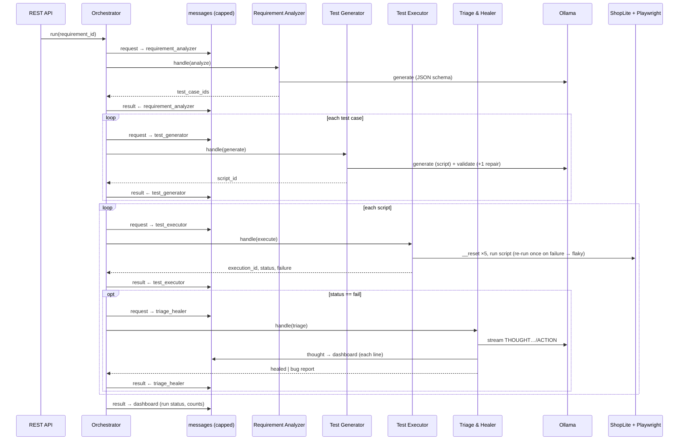

# AutoPilot-QA — Architecture

AutoPilot-QA turns a plain-English requirement into executed Playwright tests against ShopLite (five independent
microservices) and heals broken UI locators with a logged, explainable reasoning trace. Everything runs locally:
inference on Ollama, persistence in MongoDB, execution in Playwright.

## Components

| Layer | Module | Responsibility |
|---|---|---|
| API | `backend/main.py` | REST endpoints of spec §8; starts runs as background tasks |
| Orchestration | `backend/orchestrator/coordinator.py` | Task plan, sequencing, retries (≤2) and escalation, run report, coverage |
| Message bus | `backend/orchestrator/message_bus.py` | Capped `messages` collection: publish, history, tailable subscribe |
| Agents | `backend/agents/*.py` | Requirement Analyzer, Test Generator, Test Executor, Triage & Healer (Phase 8) |
| Inference | `backend/llm/ollama_client.py`, `llm/trace_parser.py` | Ollama generate/stream behind `LLMBackend`; THOUGHT/ACTION parsing |
| Execution | `backend/execution/*.py`, `tests-generated/` | Script validation, service reset, Playwright run, failure capture |
| Healing | `backend/healing/*.py` | Candidate extraction, healer prompt, DOM verification |
| Persistence | `backend/db/*.py` | Pydantic models, `init_db`, repository, selector maps |

## One run

If an agent raises, the orchestrator publishes an `error` message and sends a new `request` with `attempt + 1`.
After three attempts the task is **escalated**: it is recorded in the run report, and the run ends with status
`escalated`. An escalated analysis ends the run immediately; an escalated per-test-case task does not stop the others.

## Key decisions

- **The bus is the system of record; dispatch is in-process.** Every task produces `request` and then `result` or
  `error` messages on the capped collection, and every reasoning line is a `thought` message (also persisted to
  `agent_traces`). A run can be reconstructed from `GET /runs/{run_id}/messages`. Agents are invoked in-process by
  the coordinator rather than as separate bus consumers. That keeps retries, ordering and failure handling simple
  and deterministic, and costs nothing in explainability.
- **No agent framework** (LangGraph/CrewAI). The spec already defines the bus, retries and sequencing; a framework
  would duplicate that state and hide the message trail.
- **Logical selector keys.** Generated scripts call `sel('catalog.addToCartButton')`. Healing writes a new
  selector-map version and re-runs the unchanged script, so a heal never edits LLM-written code.
- **Verification before confidence.** A proposed locator is only applied if it resolves to exactly one element in its
  scope in the captured DOM, *and* the model's confidence reaches `HEALING_CONFIDENCE_THRESHOLD` (default 0.80).
- **Transactional healing.** An applied heal is provisional until the script's re-run passes. If the re-run still
  fails, the healed selector-map version is marked `rolled_back`, so no later run uses it, and a bug report is raised.
  The three layers split the work: the LLM proposes, DOM verification checks *structure* (exists, unique, generic),
  and the re-run checks *behaviour*. Only the re-run can tell "Add to Bag" (same job) from "Add to Wishlist"
  (different job) when a small local model can't.
- **Static validation of generated code** (no `require` other than the fixtures, no `process`, `fs`, `fetch`, `eval`,
  raw selectors, …) and `node --check` before anything runs on the host.
- **PyMongo async instead of Motor** (Motor reached end of support in May 2026).

## Collections (`autopilot_qa`)

`requirements` (with run `status`), `test_cases`, `scripts`, `executions` (with `failure`, `attempts`,
`selector_map_version`, `healing`), `bug_reports`, `agent_traces`, `coverage`, `selector_maps` (versioned; `active` or
`pending_review`), and the capped `messages` bus (64 MiB). Run-scoped collections are indexed on `run_id`.

## API

| Method | Path | Purpose |
|---|---|---|
| POST | `/requirements` | Submit a requirement → 202 `{run_id, requirement_id, status}`; the run starts in the background |
| GET | `/runs/{run_id}` | Run status, counts and all artifacts |
| GET | `/runs/{run_id}/test-cases` · `/scripts` · `/results` · `/bug-reports` · `/coverage` | Artifacts |
| GET | `/runs/{run_id}/messages` | Full bus history of the run |
| POST | `/runs/{run_id}/execute` | Re-run the run's scripts against the latest active selector map (409 while active) |
| WS | `/ws/runs/{run_id}` | Live feed (Phase 9) |
| GET | `/health` | Liveness |
